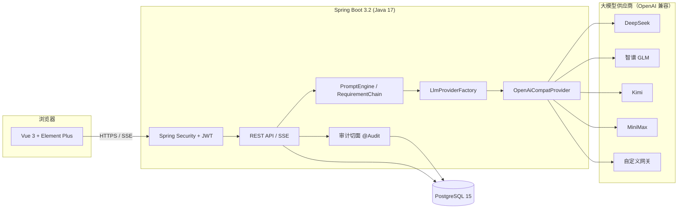

<div align="center">

# 铸语 PromptForge

**可自部署的开源 AI 提示词与需求工作台**

把一句大白话，变成大模型听得懂的专业指令 —— 管理员配置一次 API Key，全员直接用。

[](./LICENSE)
[](https://spring.io/projects/spring-boot)
[](https://openjdk.java.net/)
[](https://vuejs.org/)
[](https://element-plus.org/)
[](https://www.postgresql.org/)
[](https://docs.docker.com/compose/)

**English | [中文](#铸语-promptforge)** · 一键部署 · 多模型供应商 · SSE 流式输出

</div>

---

## ✨ 这是什么

**铸语 PromptForge** 是一个开源自部署的 AI 提示词处理工具。团队管理员配置一次大模型 API Key，所有成员即可通过浏览器使用，无需各自注册、无需暴露 Key。

两个入口，同一个提示词处理内核：

| 模块 | 处理方式 | 流程 |
| --- | --- | --- |
| **提示词生成** | 单步 | 输入需求 → SSE 流式生成结构化提示词 → 自动存历史版本 |
| **需求助手** | 多步链 | 提交原始需求 → AI 生成最多 5 个澄清问题 → 回答后生成 Markdown 需求文档 → 版本可切换回看 |

### 核心特性

- 🔌 **多模型供应商**：DeepSeek / 智谱 GLM / Kimi (Moonshot) / MiniMax / 自定义 OpenAI 兼容网关（OneAPI、NewAPI、vLLM…），后台下拉切换，业务代码零改动
- 🔐 **企业级安全**：API Key AES-256-GCM 加密落库（接口只回显末 4 位）、BCrypt 密码、JWT 双令牌、登录失败锁定、按用户限流、全量审计日志
- ⚡ **流式体验**：SSE 逐字输出，Nginx 反代已关闭缓冲，部署即可用
- 🕘 **版本可回溯**：每次生成自动落版本，随时切换对比
- 🎨 **精致 UI**：浅色天空蓝渐变设计系统，白色毛玻璃卡片，基准 16px 大字号
- 🐳 **一键部署**：Docker Compose 五个服务编排，`cp .env.example .env && docker compose up -d` 即起
- 🧩 **可扩展**：`LlmProvider` 接口预留扩展位，接入非 OpenAI 兼容协议只需新增一个实现类

## 🖼️ 截图

> 截图将于首个 Release 前补充至 `docs/screenshots/`（登录页 / 工作台 / 提示词生成 / 需求助手）。

## 🏗️ 架构



## 🤖 支持的模型供应商

| 供应商 | Base URL | 默认模型 | 获取 Key |
| --- | --- | --- | --- |
| DeepSeek | `https://api.deepseek.com` | `deepseek-chat` | [platform.deepseek.com](https://platform.deepseek.com) |
| 智谱 GLM | `https://open.bigmodel.cn/api/paas/v4` | `glm-4.5` | [open.bigmodel.cn](https://open.bigmodel.cn) |
| Kimi (Moonshot) | `https://api.moonshot.cn/v1` | `kimi-k2-0905-preview` | [platform.moonshot.cn](https://platform.moonshot.cn) |
| MiniMax | `https://api.minimax.chat/v1` | `MiniMax-Text-01` | [platform.minimaxi.com](https://platform.minimaxi.com) |
| 自定义 | 任意 OpenAI 兼容网关 | 自填 | OneAPI / NewAPI / vLLM / 中转站 |

> 切换供应商只需在管理后台下拉选择，系统自动填充 Base URL 与默认模型名。配置框内置各家「3 步获取 API Key」教程。

## 🚀 快速开始

### 方式一：Docker Compose 一键部署（推荐）

前置要求：Docker 20.10+ 与 Docker Compose v2。

```bash
# 1. 克隆仓库
git clone https://github.com/<your-org>/promptforge.git
cd promptforge

# 2. 准备环境变量（必须修改 JWT_SECRET / ENCRYPT_KEY / DB_PASSWORD / ADMIN_PASSWORD）
cp .env.example .env
vi .env

# 3. 一键启动（5 个服务：postgres / redis / backend / frontend / nginx）
docker compose up -d

# 4. 打开 http://localhost ，用 .env 里的管理员账号登录
```

### 方式二：手动部署（不使用 Docker）

前置要求：JDK 17+、Node.js 18+、PostgreSQL 15。

```bash
# 1. 初始化数据库（创建角色与库，灌入 12 张表）
psql -U postgres -c "CREATE ROLE promptforge LOGIN PASSWORD 'your_password';"
psql -U postgres -c "CREATE DATABASE promptforge OWNER promptforge;"
psql -U promptforge -d promptforge -f deploy/postgres/init.sql

# 2. 编译后端
cd backend
./mvnw -DskipTests package   # 或 mvn -DskipTests package

# 3. 启动后端（环境变量见下方表格）
java -jar target/ai-assistant-1.0.0.jar \
  --server.port=8080 \
  # 或通过环境变量：DB_HOST / DB_PORT / DB_NAME / DB_USER / DB_PASSWORD / JWT_SECRET / ENCRYPT_KEY / ADMIN_USERNAME / ADMIN_PASSWORD

# 4. 启动前端
cd ../frontend
npm install
npm run dev        # 开发模式，http://localhost:5173，已代理 /api → 8080
# 或生产模式：npm run build 后将 dist/ 交给任意静态服务器
```

> Windows 本地开发可使用仓库附带的 `start-services.bat` / `stop-services.bat` 一键启停（密钥从 git-ignored 的 `.env.local` 读取）。

### 环境变量说明

| 变量 | 必填 | 说明 |
| --- | --- | --- |
| `DB_HOST` / `DB_PORT` | 否 | 数据库地址，默认 `localhost:5432` |
| `DB_NAME` / `DB_USER` / `DB_PASSWORD` | 是 | PostgreSQL 库名 / 用户 / 密码 |
| `JWT_SECRET` | 是 | JWT 签名密钥，至少 32 字符，`openssl rand -hex 32` 生成 |
| `ENCRYPT_KEY` | 是 | API Key 的 AES-256 加密密钥，**更换后已存 Key 将无法解密** |
| `ADMIN_USERNAME` / `ADMIN_PASSWORD` | 是 | 首次启动自动创建的初始管理员，上线后请立即改密 |
| `NGINX_PORT` | 否 | Docker 部署对外端口，默认 80 |

> 后端启动即校验 `JWT_SECRET` / `ENCRYPT_KEY`：缺失或过弱会直接失败，不允许带病上线。

## 🔑 配置模型（管理员，3 分钟）

1. 管理员登录 → 左侧「模型配置」（生成页面右上角的模型状态胶囊也能就地配置）；
2. 选择**模型提供商** → 系统自动填充 Base URL 与默认模型名；
3. 粘贴该供应商的 **API Key** → 点「测试连接」→ 显示「连接成功」后启用并保存；
4. 普通用户无需任何配置，直接使用。

详细图文教程与常见报错见 [docs/操作手册.md](docs/操作手册.md)。

## 📁 目录结构

```
promptforge/
├─ backend/                     # Spring Boot 3.2 + Java 17
│  └─ src/main/java/com/chengrongjieyue/assistant/
│     ├─ common/                # 统一响应 / 错误码 / 全局异常
│     ├─ config/                # Security / MyBatis-Plus / 线程池 / 管理员初始化
│     ├─ security/              # JWT 签发解析 / 认证过滤器 / 401-403 处理
│     ├─ crypto/                # API Key AES-256-GCM 加密
│     ├─ llm/                   # LlmProvider 接口 / OpenAiCompatProvider(多供应商) / Factory
│     ├─ entity / mapper / dto / vo
│     ├─ service/               # PromptService(SSE) / RequirementService(多步链) 等
│     └─ controller/ audit/ ratelimit/
├─ frontend/                    # Vue3 + Vite + TS + Pinia + Element Plus
│  └─ src/{api,components,layouts,router,stores,utils,views}
├─ deploy/
│  ├─ nginx/nginx.conf          # 反代 + SSE 透传（proxy_buffering off）
│  └─ postgres/init.sql         # 12 张表完整 DDL + 预置数据
├─ docs/
│  ├─ 操作手册.md               # 各供应商注册/建 Key 教程 + 常见错误
│  └─ 启动与验收.md             # 部署步骤 + 验收清单
├─ docker-compose.yml           # postgres / redis / backend / frontend / nginx
├─ start-services.bat           # Windows 本地一键启停（读 .env.local）
└─ .env.example
```

## 🗺️ Roadmap

- [x] 多供应商模型适配（DeepSeek / GLM / Kimi / MiniMax / 自定义）
- [x] 提示词生成 + 需求助手双入口
- [x] SSE 流式输出 + 版本管理
- [ ] **产物向导**：一键生成 Skill / MCP / Tool / Workflow / CLI 六类 AI 产物并引导上架到自有 AI 平台
- [ ] 提示词模板市场（团队内共享）
- [ ] 更多供应商原生适配（Anthropic / Ollama 本地推理）
- [ ] 英文界面

> 有想要的功能？欢迎 [提 Issue](../../issues) 或直接 PR。

## 🤝 贡献

欢迎任何形式的贡献：

1. Fork 本仓库 → 创建特性分支（`git checkout -b feature/xxx`）
2. 提交改动（`git commit -m "feat: xxx"`）→ 推送（`git push origin feature/xxx`）
3. 发起 Pull Request

提交信息遵循 [Conventional Commits](https://www.conventionalcommits.org/zh-hans/)。

## ⭐ 支持我们

如果这个项目对你有帮助，欢迎点一个 **Star** ⭐ —— 这是我们持续维护的最大动力！

也欢迎 Watch 关注版本发布，或 Fork 出你自己的定制版。

## 🏢 关于城荣杰月

**上海城荣杰月科技有限公司（ChengRongJieYue）** 是一家专注于软件研发的科技公司，主要业务：

- 🖥️ **企业级软件定制开发** —— Web 管理系统、SaaS 平台、智慧园区 / 物联网等行业解决方案
- 🤖 **AI 智能体（Agent）应用搭建** —— 基于大模型的企业知识库、智能客服、AI 工作流自动化
- 📱 **小程序与移动端开发** —— 微信小程序、H5、跨端应用
- 🧩 **开源项目与技术支持** —— 以开源回馈社区，提供商业化部署与定制服务

我们相信：好的软件应该让业务更简单。本项目由城荣杰月团队设计并维护，欢迎通过 [GitHub Issues](../../issues) 与我们交流。

### 📮 联系我们

- 📧 **邮箱**：[646524128@qq.com](mailto:646524128@qq.com) —— 商务合作、定制咨询、部署支持均可来信
- 👥 **用户交流群**：筹建中，建好后会在这里贴出群号
- 🐞 **问题反馈**：优先推荐 [GitHub Issues](../../issues)，响应最快

> 如果这套工具帮到了你的团队，欢迎 Star ⭐ 支持，也让更多开发者看到国产开源工具的样子。

## 📄 License

[MIT](./LICENSE) © 城荣杰月 (ChengRongJieYue)
