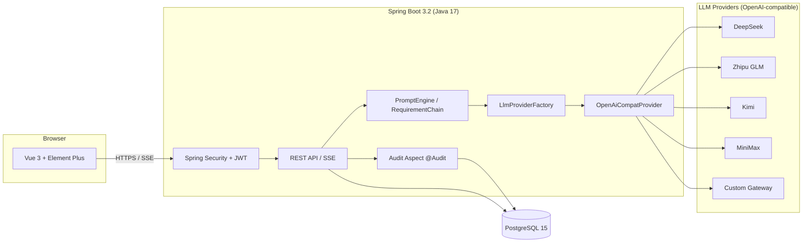

<div align="center">

# PromptForge (铸语)

**Self-hosted, open-source AI prompt & requirements workbench**

Turn a plain sentence into a professional instruction any LLM understands — admins configure the API key once, the whole team just uses it.

[](./LICENSE)
[](https://spring.io/projects/spring-boot)
[](https://openjdk.java.net/)
[](https://vuejs.org/)
[](https://element-plus.org/)
[](https://www.postgresql.org/)
[](https://docs.docker.com/compose/)

**English | [中文](./README.md)** · One-command deploy · Multi-provider LLM · SSE streaming

</div>

---

## ✨ What is this

**PromptForge** is an open-source, self-hosted AI prompt processing tool. The team admin configures an LLM API key once; everyone else uses it straight from the browser — no individual sign-ups, no exposed keys.

Two entry points, one prompt-processing core:

| Module | Mode | Flow |
| --- | --- | --- |
| **Prompt Studio** | Single-step | Describe what you need → structured prompt streams in via SSE → auto-saved with version history |
| **Requirements Assistant** | Multi-step chain | Submit a raw requirement → AI asks up to 5 clarifying questions → answers produce a Markdown requirements doc → switchable versions |

### Highlights

- 🔌 **Multi-provider LLM** — DeepSeek / Zhipu GLM / Kimi (Moonshot) / MiniMax / OpenAI / Claude / Gemini / any OpenAI-compatible gateway (OneAPI, NewAPI, vLLM…). Switch from the admin panel; zero business-code changes
- 🔐 **Enterprise-grade security** — API keys encrypted at rest with AES-256-GCM (only the last 4 chars echoed back), BCrypt passwords, dual JWT tokens, login lockout, per-user rate limiting, full audit logging
- ⚡ **Streaming UX** — token-by-token SSE output; Nginx buffering pre-configured off
- 🕘 **Version history** — every generation is snapshotted; compare and roll back anytime
- 🔄 **Full prompt lifecycle** — generate → live test-run against a real model → iterate with quick-fix directions → finalize → one-click agent publishing kit (Coze / Dify / GPTs / Tencent Yuanqi / self-hosted API)
- 🎨 **Polished UI** — light sky-blue gradient design system, frosted-glass cards, 16px base font
- 🐳 **One-command deploy** — five-service Docker Compose stack: `cp .env.example .env && docker compose up -d`
- 🧩 **Extensible** — the `LlmProvider` interface leaves room for non-OpenAI-compatible protocols; just add one implementation class

## 🖼️ Screenshots

> Screenshots will be added to `docs/screenshots/` before the first release (login / workbench / prompt studio / requirements assistant).

## 🏗️ Architecture



## 🤖 Supported Providers

| Provider | Base URL | Default Model | Get a Key |
| --- | --- | --- | --- |
| DeepSeek | `https://api.deepseek.com` | `deepseek-chat` | [platform.deepseek.com](https://platform.deepseek.com) |
| Zhipu GLM | `https://open.bigmodel.cn/api/paas/v4` | `glm-4.5` | [open.bigmodel.cn](https://open.bigmodel.cn) |
| Kimi (Moonshot) | `https://api.moonshot.cn/v1` | `kimi-k2-0905-preview` | [platform.moonshot.cn](https://platform.moonshot.cn) |
| MiniMax | `https://api.minimax.chat/v1` | `MiniMax-Text-01` | [platform.minimaxi.com](https://platform.minimaxi.com) |
| OpenAI | `https://api.openai.com/v1` | `gpt-4o` | [platform.openai.com](https://platform.openai.com) |
| Claude (Anthropic) | `https://api.anthropic.com/v1` | `claude-sonnet-4-5` | [console.anthropic.com](https://console.anthropic.com) |
| Gemini (Google) | `https://generativelanguage.googleapis.com/v1beta/openai` | `gemini-2.5-flash` | [aistudio.google.com](https://aistudio.google.com) |
| Custom | Any OpenAI-compatible gateway | Your choice | OneAPI / NewAPI / vLLM / self-hosted |

> Switching providers is a dropdown selection in the admin panel — Base URL and default model auto-fill. Each provider ships with a built-in 3-step "get your API key" guide.

## 🚀 Quick Start

### Option 1: Docker Compose (recommended)

Prerequisites: Docker 20.10+ and Docker Compose v2.

```bash
# 1. Clone
git clone https://github.com/<your-org>/promptforge.git
cd promptforge

# 2. Prepare env vars (MUST change JWT_SECRET / ENCRYPT_KEY / DB_PASSWORD / ADMIN_PASSWORD)
cp .env.example .env
vi .env

# 3. Start the 5-service stack (postgres / redis / backend / frontend / nginx)
docker compose up -d

# 4. Open http://localhost and sign in with the admin account from .env
```

### Option 2: Manual deployment (no Docker)

Prerequisites: JDK 17+, Node.js 18+, PostgreSQL 15.

```bash
# 1. Initialize the database (role + database + 12 tables)
psql -U postgres -c "CREATE ROLE promptforge LOGIN PASSWORD 'your_password';"
psql -U postgres -c "CREATE DATABASE promptforge OWNER promptforge;"
psql -U promptforge -d promptforge -f deploy/postgres/init.sql

# 2. Build the backend
cd backend
./mvnw -DskipTests package   # or: mvn -DskipTests package

# 3. Start the backend (env vars listed below)
java -jar target/ai-assistant-1.0.0.jar --server.port=8080
# env: DB_HOST / DB_PORT / DB_NAME / DB_USER / DB_PASSWORD / JWT_SECRET / ENCRYPT_KEY / ADMIN_USERNAME / ADMIN_PASSWORD

# 4. Start the frontend
cd ../frontend
npm install
npm run dev        # dev mode at http://localhost:5173, /api proxied to 8080
# or production: npm run build and serve dist/ with any static server
```

> On Windows, use the bundled `start-services.bat` / `stop-services.bat` for one-click local start/stop (secrets are read from the git-ignored `.env.local`).

### Environment Variables

| Variable | Required | Description |
| --- | --- | --- |
| `DB_HOST` / `DB_PORT` | No | Database address, defaults to `localhost:5432` |
| `DB_NAME` / `DB_USER` / `DB_PASSWORD` | Yes | PostgreSQL database / user / password |
| `JWT_SECRET` | Yes | JWT signing secret, min 32 chars — generate with `openssl rand -hex 32` |
| `ENCRYPT_KEY` | Yes | AES-256 key for API-key encryption. **Rotating it makes stored keys undecryptable** |
| `ADMIN_USERNAME` / `ADMIN_PASSWORD` | Yes | Initial admin created on first boot — change the password immediately |
| `NGINX_PORT` | No | External port for Docker deployment, defaults to 80 |

> The backend validates `JWT_SECRET` / `ENCRYPT_KEY` at startup — missing or weak values fail fast.

## 🔑 Configure a Model (admin, 3 minutes)

1. Sign in as admin → **Model Config** in the sidebar (the model status pill on any studio page works too);
2. Pick a **provider** → Base URL and default model auto-fill;
3. Paste the provider's **API Key** → **Test Connection** → enable and save once it shows success;
4. Regular users need zero configuration.

## 📁 Project Layout

```
promptforge/
├─ backend/                     # Spring Boot 3.2 + Java 17
│  └─ src/main/java/com/chengrongjieyue/assistant/
│     ├─ common/                # Unified response / error codes / global exception handler
│     ├─ config/                # Security / MyBatis-Plus / thread pools / admin initializer
│     ├─ security/              # JWT issue & parse / auth filter / 401-403 handlers
│     ├─ crypto/                # AES-256-GCM API-key encryption
│     ├─ llm/                   # LlmProvider interface / OpenAiCompatProvider (multi-provider) / factory
│     ├─ entity / mapper / dto / vo
│     ├─ service/               # PromptService (SSE) / RequirementService (multi-step chain) etc.
│     └─ controller/ audit/ ratelimit/
├─ frontend/                    # Vue 3 + Vite + TS + Pinia + Element Plus
│  └─ src/{api,components,layouts,router,stores,utils,views}
├─ deploy/
│  ├─ nginx/nginx.conf          # Reverse proxy + SSE passthrough (proxy_buffering off)
│  └─ postgres/init.sql         # Full DDL for 12 tables + seed data
├─ docs/                        # Chinese manuals: operation guide & deployment acceptance
├─ docker-compose.yml           # postgres / redis / backend / frontend / nginx
├─ start-services.bat           # Windows one-click start/stop (reads .env.local)
└─ .env.example
```

## 🗺️ Roadmap

- [x] Multi-provider LLM support (DeepSeek / GLM / Kimi / MiniMax / custom)
- [x] Prompt Studio + Requirements Assistant
- [x] SSE streaming + version management
- [x] Full prompt lifecycle: test-run / iterate / finalize / agent publishing kit
- [ ] **Artifact wizard**: one-click generation of Skill / MCP / Tool / Workflow / CLI artifacts with publishing guides
- [ ] Team prompt template marketplace
- [ ] Native provider adapters (Anthropic / local Ollama inference)
- [ ] English UI

> Want a feature? [Open an issue](../../issues) or send a PR.

## 🤝 Contributing

All contributions are welcome:

1. Fork this repo → create a feature branch (`git checkout -b feature/xxx`)
2. Commit your changes (`git commit -m "feat: xxx"`) → push (`git push origin feature/xxx`)
3. Open a Pull Request

Please follow [Conventional Commits](https://www.conventionalcommits.org/).

## ⭐ Support the Project

If this project helps you, consider leaving a **Star** ⭐ — it's the biggest motivation for continued maintenance!

Feel free to Watch for releases, or Fork it into your own customized edition.

## 🏢 About ChengRongJieYue

**Shanghai ChengRongJieYue Technology Co., Ltd.** is a software engineering company focused on:

- 🖥️ **Custom enterprise software** — web management systems, SaaS platforms, smart-campus / IoT solutions
- 🤖 **AI agent (Agent) applications** — enterprise knowledge bases, intelligent customer service, AI workflow automation
- 📱 **Mini-programs & mobile apps** — WeChat mini-programs, H5, cross-platform apps
- 🧩 **Open source & technical support** — giving back to the community, with commercial deployment and customization services

We believe great software should make business simpler. This project is designed and maintained by the ChengRongJieYue team.

### 📮 Contact

- 📧 **Email**: [646524128@qq.com](mailto:646524128@qq.com) — business cooperation, custom development, deployment support
- 👥 **User group**: coming soon — the group number will be posted here
- 🐞 **Bug reports**: [GitHub Issues](../../issues) is the fastest channel

> If this tool helps your team, a Star ⭐ is much appreciated!

## 📄 License

[MIT](./LICENSE) © ChengRongJieYue (城荣杰月)
